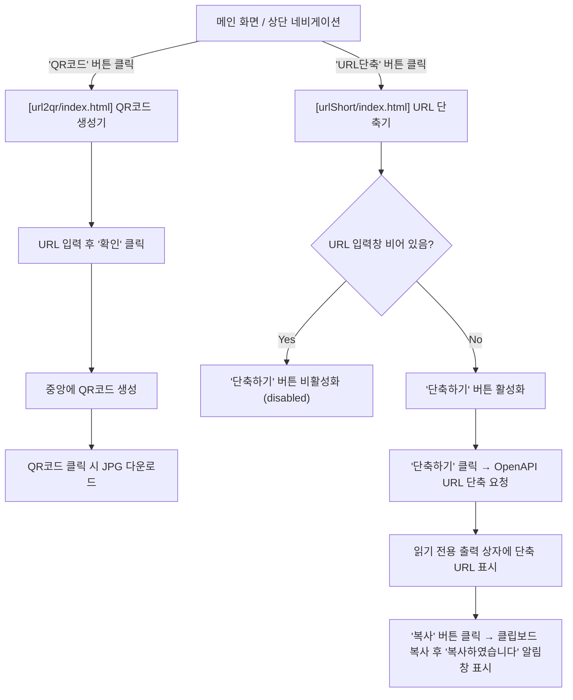

# QR코드 & URL단축 웹 애플리케이션 (Project06)

## 1. 프로젝트 개요 (Project Overview)

### 1.1 프로젝트 명
**URL 툴박스 (QR코드 생성 & URL 단축 웹 앱)**

### 1.2 개발 목적
긴 URL을 간편하게 **QR 코드 이미지(JPG)**로 변환하거나, **OpenAPI를 활용해 짧은 URL로 단축**하고 원클릭으로 복사할 수 있는 통합 웹 유틸리티 애플리케이션입니다.

### 1.3 프로젝트 디렉터리 구조
```text
Project06/
├── index.html          # 메인 허브 페이지 ('QR코드', 'URL단축' 버튼 제공)
├── README.md           # 프로젝트 개요 및 기능 명세서
├── url2qr/             # QR코드 생성 기능 폴더
│   ├── index.html      # QR코드 생성 페이지 UI
│   ├── style.css       # 스타일시트 (반응형 및 인터랙티브 그라데이션)
│   ├── script.js       # QR코드 렌더링 및 JPG 다운로드 로직
│   └── img/
│       └── logo.png    # 브랜드 로고 이미지
└── urlShort/           # URL단축 기능 폴더
    ├── index.html      # URL단축 페이지 UI
    ├── style.css       # URL단축 전용 스타일시트
    ├── script.js       # OpenAPI 연동 URL단축 및 클립보드 복사 로직
    └── img/
        └── logo.png    # 브랜드 로고 이미지
```

### 1.4 사용 기술 스택
- **Frontend**: HTML5, CSS3 (Flexbox, CSS Variables, Glassmorphism), Vanilla JavaScript (ES6+, Fetch API, Clipboard API)
- **외부 라이브러리 & OpenAPI**:
  - `qrcode-generator` (v1.4.4 CDN): Canvas 기반 고해상도 QR 코드 생성
  - `is.gd` / `da.gd` OpenAPI: 별도 인증키 없이 브라우저 CORS 환경에서 즉시 호출 가능한 URL 단축 OpenAPI

---

## 2. 기능 명세서 (Functional Specification)

### 2.1 공통 네비게이션 기능
| 기능 ID | 기능명 | 상세 설명 | 연결 경로 |
| :--- | :--- | :--- | :--- |
| **NAV-01** | **QR코드 이동 버튼** | `'QR코드'` 버튼 클릭 시 QR코드 생성 페이지로 이동 | `url2qr/index.html` |
| **NAV-02** | **URL단축 이동 버튼** | `'URL단축'` 버튼 클릭 시 URL단축 페이지로 이동 | `urlShort/index.html` |
| **NAV-03** | **로고 홈 이동** | 좌측 상단 로고 클릭 시 처음 화면(`../index.html`)으로 이동 | `../index.html` |

---

### 2.2 QR코드 생성 기능 (`[url2qr]`)
| 기능 ID | 기능명 | 입력 / 조건 | 처리 및 출력 결과 |
| :--- | :--- | :--- | :--- |
| **QR-01** | **URL 입력 및 보정** | 사용자가 URL 입력 후 `'확인'` 클릭 | 프로토콜(`http://`, `https://`) 누락 시 `https://` 자동 보정 |
| **QR-02** | **QR코드 캔버스 렌더링** | 유효한 URL 입력 시 | 640x640 고해상도 `<canvas>`에 흰색 배경 및 QR 모듈 렌더링 후 화면 중앙 배치 |
| **QR-03** | **JPG 파일 다운로드** | 생성된 QR코드 카드 클릭 (또는 Enter/Space) | `canvas.toDataURL('image/jpeg', 0.98)`을 사용하여 `qr-{도메인}.jpg` 파일 자동 다운로드 |

---

### 2.3 URL단축 기능 (`[urlShort]`)
| 요구사항 번호 | 기능명 | 상세 동작 명세 | 관련 요소 (ID) |
| :--- | :--- | :--- | :--- |
| **3-1** | **UI 구성 요소 배치** | `'URL 입력'` 입력창, `'단축하기'` 버튼, `'읽기 전용(readonly) 출력 상자'`, `'복사'` 버튼 제공 | `#urlInput`, `#shortenBtn`, `#shortUrlOutput`, `#copyBtn` |
| **3-2** | **입력값 유무에 따른 버튼 활성화 제어** | `'URL 입력'` 필드가 비어 있거나 공백만 존재할 경우 `'단축하기'` 버튼을 비활성화(`disabled`) 처리하고, 텍스트 입력 시 즉시 활성화 | `input` 이벤트 리스너, `shortenBtn.disabled` |
| **3-3** | **OpenAPI 연동 URL 단축 요청 및 출력** | `'단축하기'` 클릭 시 입력된 URL을 보정하여 URL 단축 OpenAPI(`is.gd` JSON API, 폴백 `da.gd`)에 비동기(`fetch`) 요청을 보내고, 응답받은 단축 URL을 읽기 전용 출력 상자에 표시 | `requestShortUrl()`, `#shortUrlOutput.value` |
| **3-4** | **단축 URL 자동 복사 및 알림창 표시** | `'복사'` 버튼 클릭 시 읽기 전용 출력 상자의 단축 URL을 클립보드에 자동 복사(`navigator.clipboard.writeText` 및 `execCommand('copy')` 지원)한 뒤 `'복사하였습니다'` 브라우저 알림창(`alert`) 표시 | `#copyBtn` 클릭 이벤트, `alert('복사하였습니다')` |

---

## 3. 화면 흐름도 (User Flow)


